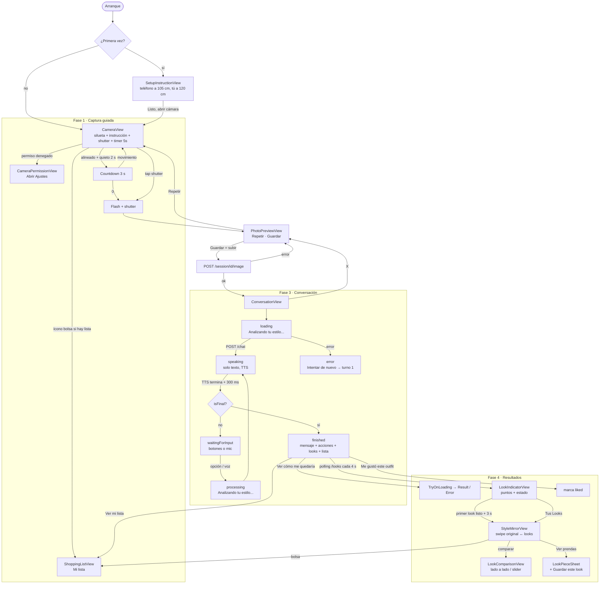

# Auditoría UX del flujo — app iOS guaperrimo.ai

**Fecha:** 11 de octubre de 2026
**Método:** lectura estática de todo el código SwiftUI (vistas, view models, servicios, strings, assets). No se ejecutó la app en dispositivo ni simulador; ver §8 para lo que falta verificar.
**Documento hermano:** [`reporte-mejoras-ux-ios.md`](reporte-mejoras-ux-ios.md) con las recomendaciones y el rediseño propuesto.

---

## 0. Resumen en una pantalla

| Fase | Pantallas | Veredicto |
|------|-----------|-----------|
| 1. Captura guiada | `SetupInstructionView`, `CameraView`, `BodySilhouetteOverlay`, `CameraPermissionView` | ✅ Sólida. Máquina de estados, histéresis, countdown, flash, haptics. Mejorable en guía por voz y preview espejado. |
| 2. Confirmar y subir foto | `PhotoPreviewView` | ⚠️ Funciona, pero el botón dice "Guardar" cuando en realidad inicia el análisis. Deja un callejón sin salida al regresar. |
| 3. Conversación con el estilista ("generar el outfit") | `ConversationView`, `ThinkingIndicatorView` | 🔴 La más débil. Pantalla negra con un párrafo centrado; la foto del usuario desaparece; sin historial; TTS bloqueante sin forma de saltarlo; indicador de carga desalineado. |
| 4a. Resultados: acciones + try-on | `PriorityActionCardView`, `TryOnLoadingView`, `TryOnResultView`, `TryOnErrorView` | ⚠️ Correctas pero con lenguaje de "product management" (Impacto/Esfuerzo) y barra de progreso falsa con porcentaje. |
| 4b. Resultados: looks | `LookIndicatorView`, `StyleMirrorView` (+ Overlay, Canvas, Background), `LookComparisonView`, `LookPieceSheet` | ✅ El punto fuerte visual. Crossfade con precarga, slider antes/después, haptics. Se abre solo a los 3 s (interrumpe). |
| 4c. Guardar ("guardar los outfits") | `shoppingListActions` en `ConversationView`, `LookPieceSheet` (guardar look), `ShoppingListView` | 🔴 Tres botones de "guardar" con semánticas distintas, una sola lista que se sobreescribe sin aviso, markdown crudo en pantalla, sin forma de borrar. |

Hallazgos transversales (§5): identidad visual inexistente (sin ícono, sin acento, sin tipografía), componentes duplicados en cada vista, accesibilidad mínima, controles de debug visibles en release, acentos inconsistentes en los textos.

---

## 1. Alcance y método

### 1.1 Qué se auditó

| Fuente | Commit / estado | Contenido relevante |
|--------|-----------------|---------------------|
| Rama `main` | `83976e2` (9 mar 2026) | Captura, preview, conversación, acciones prioritarias. |
| Rama `shopping-list` | `9106a14` (11 oct 2026, también en `origin`) | + looks, Style Mirror, try-on, "Mi lista", Sentry. Es el estado más completo de la app. |
| Working copy `~/Documents/guaperrimo.ai` | 11 archivos modificados sin commit sobre `9106a14` | Auto‑guardado de lista al terminar, botón "Me gustó este outfit", "Guardar este look en mi lista" dentro de `LookPieceSheet`, acceso a "Mi lista" desde el Style Mirror. |

La auditoría describe el flujo de `shopping-list` + working copy, que es lo que ves hoy al correr desde Xcode. Cuando algo difiere de `main` se indica.

### 1.2 Cómo leer los hallazgos

- 🔴 **Alta**: bloquea o confunde la tarea principal (entender mi estilo, ver looks, guardar).
- 🟠 **Media**: fricción clara, el usuario llega pero con esfuerzo o dudas.
- 🟡 **Baja**: pulido, consistencia, detalle.

Cada hallazgo tiene un ID (`C-n` cámara, `P-n` preview, `S-n` sesión/conversación, `R-n` resultados, `L-n` looks, `G-n` guardar, `T-n` transversal) para referenciarlo desde el reporte.

---

## 2. Mapa del flujo

### 2.1 Diagrama

### 2.2 Modelo de navegación

| Desde | Hacia | Presentación | Regreso |
|-------|-------|--------------|---------|
| `CameraView` | `PhotoPreviewView` | `fullScreenCover` | "Repetir" → `retakePhoto()` |
| `PhotoPreviewView` | `ConversationView` | `fullScreenCover` (anidado) | X → vuelve al preview **con la foto ya subida** |
| `ConversationView` | `TryOnContainerView` | `fullScreenCover` | X / Listo / Volver |
| `ConversationView` | `StyleMirrorView` | `fullScreenCover` | X |
| `ConversationView` | `ShoppingListView` | `sheet` | X / swipe |
| `StyleMirrorView` | `LookComparisonView` | `fullScreenCover` (3er nivel) | X / Listo |
| `StyleMirrorView` | `LookPieceSheet` | `sheet` (detents medium/large) | swipe |
| `StyleMirrorView` | `ShoppingListView` | `sheet` (working copy) | swipe |
| `CameraView` | `ShoppingListView` | `sheet` | swipe |

Observaciones:

- Hasta **tres `fullScreenCover` anidados** (Camera → Preview → Conversation → Mirror → Comparison). No hay `NavigationStack` ni coordinador; cada vista decide a dónde ir.
- No existe una pantalla "home". La app arranca en la cámara. El único acceso a lo guardado es un ícono flotante sobre el visor.
- Cerrar la conversación con X **no termina la sesión**: regresa a `PhotoPreviewView` con el botón "Foto guardada" deshabilitado (P-3).

---

## 3. Inventario de pantallas

### 3.1 `SetupInstructionView` — onboarding (una sola vez)

**Archivo:** `Views/CameraView.swift` (struct al inicio del archivo).
**Qué ve el usuario:** fondo negro, ícono SF `iphone.and.arrow.left.and.arrow.right` 64 pt, "↔ 120 cm" en verde, párrafo de instrucción, botón blanco "Listo, abrir cámara".
**Persistencia:** `UserDefaults` `hasSeenCameraOnboarding`.

| ID | Sev. | Hallazgo |
|----|------|----------|
| C-1 | 🟠 | No explica **qué hace la app ni qué va a pasar** (foto → estilista → looks). Pasa directo a la logística ("apoya el teléfono a 105 cm"). Un usuario nuevo no tiene motivo para dar permiso de cámara. |
| C-2 | 🟡 | Un solo ícono SF genérico como "ilustración". No comunica postura ni encuadre; la silueta que verá después no aparece aquí. |
| C-3 | 🟡 | Texto `onboarding_instruction` en `.body` con `~105 cm` y `120 cm` en una frase; difícil de recordar. Mejor dos pasos visuales. |

### 3.2 `CameraView` — captura guiada

**Archivos:** `Views/CameraView.swift`, `Views/BodySilhouetteOverlay.swift`, `Camera/*`.
**Capas:** preview (sin espejo) → silueta punteada (70 % alto, dash 10/5) → controles (banner, instrucción, timer 5 s, shutter 72 pt, hueco de balance) → flash → permiso → debug (shake).
**Estados visibles:** `noPerson` (silueta parpadea), `tooFar/tooClose/offCenter` (silueta blanca 25 %), `aligned` (verde 70 %), `stillConfirmed` (verde + pulso + countdown 3 s con anillo).

Lo que funciona bien: histéresis de 8 frames evita parpadeo de instrucciones; countdown se cancela si te mueves; sonido de obturador; flash; textos cortos y accionables.

| ID | Sev. | Hallazgo |
|----|------|----------|
| C-4 | 🟠 | **El usuario está a 120 cm de la pantalla.** Las instrucciones son texto `.callout` (~16 pt) dentro de una cápsula; a esa distancia son casi ilegibles. No hay guía por voz ni haptics (el teléfono está en una superficie). La información más importante del flujo depende del canal menos accesible. |
| C-5 | 🟠 | Preview **sin espejo** (`isVideoMirrored = false`). La lógica de "muévete a la izquierda/derecha" es físicamente correcta, pero en pantalla el usuario se ve moviéndose al revés de lo habitual en selfies. Convención iOS: preview espejado, foto final sin espejo. |
| C-6 | 🟠 | Botón **"5s" (timer de debug)** visible en builds de release: no está dentro de `#if DEBUG`, y al dispararse compone sobre la foto el overlay de debug (puntos de joints, texto monoespaciado). Un usuario real puede terminar con una foto "rayada". |
| C-7 | 🟡 | Banner permanente "Teléfono a 105 cm · Distancia 120 cm" para usuarios recurrentes ocupa la parte superior para siempre. Debería desaparecer tras N sesiones o al detectar persona. |
| C-8 | 🟡 | Jerarquía de controles: el timer 5 s pesa visualmente igual que el shutter (anillo 50 pt); el hueco derecho `Color.clear` revela que falta un tercer control (p. ej. galería o cambiar cámara). |
| C-9 | 🟡 | El ícono de bolsa (acceso a "Mi lista") flota arriba‑izquierda sobre el visor, en la misma zona del banner. Es la única puerta a lo guardado en toda la app. |
| C-10 | 🟡 | `CameraPermissionView` correcta (ícono, título, texto, Abrir Ajustes), pero se superpone al visor en lugar de reemplazarlo; detrás se ve la silueta parpadeando. |

### 3.3 `PhotoPreviewView` — confirmar y subir ("guardar la foto")

**Archivo:** `Views/PhotoPreviewView.swift`.
**Qué ve el usuario:** foto `scaledToFit` sobre negro; abajo dos cápsulas: "Repetir" (material translúcido) y "Guardar" (blanca, ícono `square.and.arrow.up`). Al tocar "Guardar": spinner → cápsula verde "Foto guardada" + botón cambia a "Foto guardada ✓" → se abre la conversación.

| ID | Sev. | Hallazgo |
|----|------|----------|
| P-1 | 🔴 | **"Guardar" no guarda: sube la foto e inicia el análisis.** El ícono `square.and.arrow.up` es el de *compartir* en iOS. El usuario no sabe que va a empezar una conversación con voz. Debería decir lo que pasa: "Analizar mi outfit". |
| P-2 | 🟠 | Doble confirmación redundante: cápsula verde "Foto guardada" + botón "Foto guardada ✓", ambos visibles ~0 ms antes de que el `fullScreenCover` tape todo. Trabajo visual que nadie ve. |
| P-3 | 🔴 | **Callejón sin salida al regresar.** Si el usuario cierra la conversación con X, vuelve aquí con `isSaved = true`: el botón principal queda deshabilitado y solo puede "Repetir". Pierde sesión, looks y lista sin aviso. |
| P-4 | 🟡 | Sin indicación de progreso de subida (una foto `.high` a JPEG 0.85 son 1‑3 MB; en red local es rápido, en LTE no). El spinner no comunica tiempo. |
| P-5 | 🟡 | Error de subida muestra `error.localizedDescription` en rojo `.caption` dentro de una cápsula: texto técnico ("Server error 500: {…}") en la cara del usuario. |
| P-6 | 🟡 | No hay zoom/pan ni verificación de encuadre (¿se ven los zapatos?), que es justamente lo que el estilista necesita. |

### 3.4 `ConversationView` — sesión con el estilista ("generar el outfit")

**Archivos:** `Views/ConversationView.swift`, `ViewModels/ConversationViewModel.swift`, `Views/ThinkingIndicatorView.swift`.
**Layout:** header (X · "guaperrimo.ai" · hueco) → `Spacer` → contenido según estado → `Spacer`. Siempre sobre negro.

Estados y lo que se renderiza:

| Estado | Render | Duración típica |
|--------|--------|-----------------|
| `loading` | `ThinkingIndicatorView` (3 puntos + "Analizando tu estilo...") | POST /chat con timeout 180 s; análisis de imagen + LLM, decenas de segundos |
| `speaking` | **Solo** `Text(currentMessage)` `.title3` centrado | Ida y vuelta a ElevenLabs (request → MP3) + duración del audio. Sin botones. |
| `waitingForInput` | mensaje + botones (cápsulas gris 15 %) **o** mic push‑to‑talk | hasta que el usuario responde |
| `processing` | `ThinkingIndicatorView` otra vez con **el mismo texto** "Analizando tu estilo..." | otra llamada LLM |
| `finished` | `ScrollView`: mensaje, tarjetas de acciones, `LookIndicatorView`, botones de lista | — |
| `error` | triángulo naranja + "Algo salió mal" + "Intentar de nuevo" | — |

| ID | Sev. | Hallazgo |
|----|------|----------|
| S-1 | 🔴 | **La foto del usuario desaparece.** El estilista habla de "tu look casual con buenas proporciones" y la pantalla es negra con texto. El objeto de la conversación no está presente. Es la razón principal de que la pantalla se sienta vacía/fea. |
| S-2 | 🔴 | **Estado `speaking` bloquea todo.** Mientras suena el TTS no hay botones, no se puede saltar ni silenciar, y no hay indicador de que está hablando (ni onda, ni ícono). El usuario ve un párrafo estático y no sabe si la app se congeló. La espera es doble: red a ElevenLabs + reproducción. |
| S-3 | 🔴 | **Sin historial.** Cada respuesta reemplaza `currentMessage`. No se puede releer la pregunta anterior ni lo que uno contestó. En una conversación de 2‑3 turnos con voz, perder contexto es grave. |
| S-4 | 🟠 | `ThinkingIndicatorView` termina en `Spacer()` dentro de un `HStack` con padding 16: **queda alineado a la izquierda** mientras todo lo demás está centrado. Mismo texto "Analizando tu estilo..." tanto en el primer análisis como al procesar una respuesta de botón. |
| S-5 | 🟠 | Header dice **"guaperrimo.ai"** (marca) en lugar de contexto ("Tu estilista" · "Turno 2 de 3"). No hay indicador de progreso de la conversación; el usuario no sabe cuántas preguntas faltan. |
| S-6 | 🟠 | **Push‑to‑talk** con `DragGesture(minimumDistance: 0)`: un *tap* corto inicia y detiene la grabación en ~100 ms → transcript vacío → **no pasa nada, sin feedback**. El hint "Mantén presionado para hablar" está en `.caption` 60 % de opacidad. |
| S-7 | 🟠 | Paso extra de **confirmar transcript** (Enviar / Repetir) después de soltar. Añade un toque a cada respuesta por voz. Útil si el STT falla, pero debería ser opcional (enviar automático con 2 s para cancelar). |
| S-8 | 🟠 | Botones de opción deshabilitados al 40 % durante `speaking` sin explicar por qué. Parece un bug. |
| S-9 | 🟠 | `retry()` llama a `startConversation()`: **reinicia desde el turno 1** aunque el error haya sido en el turno 3. El backend mantiene la sesión, pero la app vuelve a pedir el análisis de imagen. |
| S-10 | 🟠 | Mensaje de error único y genérico ("Algo salió mal. Intenta de nuevo.") para timeout, 500, sin red y decode. El de micrófono sí distingue permiso denegado. |
| S-11 | 🟡 | X en el header cierra todo sin confirmación, a mitad de un análisis que tardó 30‑60 s. |
| S-12 | 🟡 | `requestAuthorization()` pide **micrófono y reconocimiento de voz en `onAppear`**, antes de que el usuario sepa que hablará. Dos alertas del sistema seguidas, sin contexto. Mejor pedirlas al llegar al primer turno de voz. |

### 3.5 Pantalla final (`finished`) y `PriorityActionCardView`

**Qué ve el usuario (de arriba abajo):** mensaje final `.title3` centrado (3‑4 líneas) → tarjetas de acciones (título, descripción, badges "Impacto: alto" "Esfuerzo: bajo", botón gradiente morado→azul "Ver cómo me quedaría") → `LookIndicatorView` (puntos verdes/grises, "Generando tus looks..." o "¡Tu primer look está listo!" + CTA gradiente "Tus Looks") → "Ver mi lista" (blanco) → "Me gustó este outfit" (cápsula gris) o "Guardado como favorito".

| ID | Sev. | Hallazgo |
|----|------|----------|
| R-1 | 🔴 | **Jerarquía plana.** El momento "wow" (tu foto con el look nuevo) está debajo del fold, detrás del mensaje y de 3‑4 tarjetas. El mensaje final centrado en `.title3` compite con todo. |
| R-2 | 🟠 | **Se abre solo** el Style Mirror 3 s después de que el primer look está listo (`scheduleAutoOpen`). Interrumpe la lectura de las acciones y puede ocurrir mientras el usuario está tocando otra cosa. |
| R-3 | 🟠 | Badges **"Impacto: alto / Esfuerzo: bajo"**: vocabulario de gestión de producto, no de un estilista. Además los strings están hardcoded en español (`PriorityActionCardView.swift:25-26`), sin localizar. |
| R-4 | 🟠 | **Tres colores semánticos a la vez** en cada tarjeta (verde/naranja/rojo por impacto y esfuerzo, fondo tintado verde o naranja, borde) **más** el gradiente morado→azul del CTA. Ruido cromático; nada destaca. |
| R-5 | 🟠 | `LookIndicatorView` muestra `max(totalCount, 3)` puntos aunque el backend aún no haya dicho cuántos looks hay; mientras tanto un `ProgressView` pequeño al 50 %. Poco informativo durante los 30‑90 s que tarda la generación. |
| R-6 | 🟡 | Mensajes de timeout ("Tardando más de lo esperado...", "Seguimos trabajando. Puedes revisar más tarde.") en naranja, pero **no hay dónde "revisar más tarde"**: si el usuario cierra, pierde la sesión (P-3). |
| R-7 | 🟡 | El CTA "Tus Looks" y "Ver cómo me quedaría" comparten el mismo gradiente; "Ver mi lista" es blanco; "Me gustó" es gris. Cuatro estilos de botón en una pantalla sin regla clara de primario/secundario. |

### 3.6 Try‑on (`TryOnLoadingView`, `TryOnResultView`, `TryOnErrorView`)

| ID | Sev. | Hallazgo |
|----|------|----------|
| R-8 | 🟠 | **Barra de progreso falsa con porcentaje**: `1 - exp(-t/10)` con tope 95 % y un `Text("\(Int(progress*100))%")`. Promete precisión que no existe; si el servidor tarda 25 s, el usuario ve "95 %" congelado. Los textos por tiempo transcurrido ("Buscando la prenda perfecta...") están bien; el número no. |
| R-9 | 🟡 | `TryOnResultView` y `LookComparisonView` son **el mismo layout duplicado** (picker segmentado, lado a lado, slider, botón Listo). Dos fuentes de verdad para una interacción idéntica. |
| R-10 | 🟡 | El `Picker` segmentado usa el estilo del sistema (gris claro) sobre fondo negro: único control "de sistema" en toda la app, desentona. |
| R-11 | 🟡 | En `LookComparisonView` el slider dispara `selectionChanged()` **en cada cambio del drag** (decenas de veces por segundo). En `TryOnResultView` no. Inconsistente y potencialmente molesto. |
| R-12 | 🟡 | Resultado del try‑on: título de la acción en `.subheadline` y descripción `.caption` debajo de la imagen; no hay CTA para "guardar esta prenda" ni para ir a comprarla, que es el siguiente paso natural. |

### 3.7 Style Mirror (`StyleMirrorView`, `StyleMirrorOverlayView`, `StyleMirrorCanvasView`, `StyleMirrorBackgroundView`)

Lo que funciona bien: crossfade con easing smoothstep, precarga de imágenes (`ImagePreloader`), resistencia en los bordes y cuando la imagen vecina no está lista (con hint "Generando tu look..."), haptics al 50 % y al snap, grid de puntos "respirando" de fondo, overlay que se desvanece al arrastrar. Es la pantalla con más cuidado de toda la app.

| ID | Sev. | Hallazgo |
|----|------|----------|
| L-1 | 🟠 | La **CTA principal "Ver prendas" es una cápsula gris 10 %** con borde 20 %: el botón de menor contraste en la pantalla más importante. Y en la working copy el "guardar" vive dentro de esa sheet, dos toques más abajo. |
| L-2 | 🟠 | Navegación solo por puntos (6‑8 pt) y chevrons al 30 %. No hay nombres de look visibles salvo el actual en el header; no se puede saltar al look 3 directamente. |
| L-3 | 🟡 | El primer item es **"Original"** (tu foto). Útil para comparar, pero al abrir el espejo el usuario ve lo que ya vio en el preview y debe deslizar para ver lo nuevo. |
| L-4 | 🟡 | `canvasHeight = 0.8 * alto` + overlay encima: en iPhone pequeños el header y el botón inferior se montan sobre la imagen (no hay safe area explícita para el canvas). |
| L-5 | 🟡 | Looks fallidos desaparecen silenciosamente del espejo (`mirrorItems` filtra `status == "ready"`); si los 3 fallan, `lookState = .hidden` y el indicador desaparece sin mensaje. |
| L-6 | 🟡 | `LookPieceSheet` muestra la categoría como `"upper_body" → "Upper body"` (inglés, `capitalized`) aunque existe `slotLabel()` localizado ("Arriba"). |

### 3.8 Guardar: `shoppingListActions`, `LookPieceSheet` (guardar look) y `ShoppingListView`

Hoy existen **tres acciones de "guardar" con significados distintos**:

| Botón | Dónde | Qué hace realmente |
|-------|-------|--------------------|
| "Guardar" | `PhotoPreviewView` | Sube la foto e inicia la conversación (P-1). |
| "Me gustó, guardar mi lista" → en working copy "Me gustó este outfit" ♥ | final de `ConversationView` | Committed: guarda la lista de compras y la abre. Working copy: la lista **ya se auto‑guardó** al llegar la respuesta final; el corazón solo marca `liked = true` y no hace nada visible salvo cambiar el texto a "Guardado como favorito". |
| "Guardar este look en mi lista" | `LookPieceSheet` (working copy) | **Reemplaza** la lista completa por las prendas de ese look (`ShoppingListStore.save`). Sin aviso de que se pierde la lista anterior. |

| ID | Sev. | Hallazgo |
|----|------|----------|
| G-1 | 🔴 | **Modelo mental roto:** "guardar" significa tres cosas; "Mi lista" es un singleton que se sobreescribe (`ShoppingListStore.current`). Guardar el look 2 borra la lista del estilista; guardar el look 3 borra el look 2. El usuario no puede guardar *outfits*, solo *una lista de productos*. |
| G-2 | 🔴 | **No se guarda la imagen del look.** `SavedShoppingList` tiene `summary`, `items`, `stores`, `totalMxn`, `purchased`. Ni `finalImageUrl` ni la foto original. "Mi lista" no puede mostrar cómo te quedaba el outfit que te gustó. |
| G-3 | 🟠 | **Markdown crudo en pantalla.** El backend manda descripciones como `"Saco azul marino slim (talla M o L …). **Precio: $539**"` (ver `ShoppingListDecodingTests.swift`). `ShoppingListView` las renderiza con `Text(item.description)` → se ven los asteriscos. |
| G-4 | 🟠 | **Títulos de producto sin limpiar**: "Hombres - Beige Camisa Regular Fit Easy-Care en mezcla de lino - Talla: CH - H&M" (2 líneas truncadas), "Señoras H&M Café Cinturón" (producto de mujer en app para hombres). `store` vacío deja `"$740 MXN · "` con el punto colgando. |
| G-5 | 🟠 | Los `link` de productos son **búsquedas de Google Shopping** (`google.com/search?ibp=oshop…`), no la tienda. El botón dice "Comprar" pero abre un buscador. |
| G-6 | 🟠 | **No hay forma de borrar** la lista ni de marcar "ya no me interesa" (`ShoppingListStore.clear()` existe pero nada lo llama). |
| G-7 | 🟠 | `summaryCard` muestra el **mensaje completo del estilista** (3‑4 líneas) como resumen de la lista, más "Guardada el 11 oct" y el total en `.caption`. El total aproximado, que es lo que importa al ir de compras, es el dato más pequeño. |
| G-8 | 🟡 | Jerarquía del ítem: etiqueta de slot en mayúsculas con tracking ("ARRIBA") + descripción `.subheadline` en la misma línea; el `why` debajo; luego la tarjeta del producto. Cuatro niveles tipográficos para una sola prenda; se lee denso. |
| G-9 | 🟡 | "Tiendas cerca con algo de tu lista" al final, como lista plana con distancia. Para el objetivo del producto (tiendas caminables dentro de presupuesto) debería ser el eje de agrupación, no un apéndice. |
| G-10 | 🟡 | Estado vacío correcto (bolsa + texto), pero inalcanzable en la práctica: la bolsa solo aparece en cámara `if shoppingStore.hasList`. |
| G-11 | 🟡 | Marcar como comprado: `strikethrough` + fondo 4 % en lugar de 8 %. Sutil al punto de parecer un glitch; sin animación ni agrupación de comprados. |

---

## 4. Sistema visual de facto

No existe un sistema de diseño; esto es lo que emerge del código.

| Elemento | Uso actual | Problema |
|----------|-----------|----------|
| Fondo | `Color.black` en **todas** las pantallas | Negro puro + blanco puro = máximo contraste, cero atmósfera. El Style Mirror lo mitiga con el grid de puntos; las demás no. |
| Superficies | `white.opacity(0.06 / 0.08 / 0.10 / 0.12 / 0.15)` | Cinco opacidades distintas para "tarjeta" sin regla. |
| Botón primario | cápsula blanca, texto negro `.headline` | Consistente, pero compite con el gradiente. |
| Botón "IA" | `LinearGradient(.purple → .blue)` en cápsula | Aparece en try‑on, "Ver prendas" (en carrusel muerto), "Tus Looks". Único color de marca, sin definir en Assets. |
| Botón secundario | cápsula `white 0.1‑0.15` con/sin borde `white 0.2‑0.3` | Tres variantes. |
| Éxito / alineado | `.green` (15 usos) | Verde de sistema, saturado, sobre negro. |
| Advertencia / error | `.orange` (9), `.red` (7) | Rojo también para "grabando". |
| Radios | 10, 12, 14, 16, 20, 24 | Seis radios. |
| Padding horizontal | 16, 20, 24, 32, 40 | Cinco anchos de contenido. |
| Tipografía | fuentes del sistema; `.system(size:)` fijo en X (16), mic (30), íconos (36‑64) | Sin escala propia; los tamaños fijos no escalan con Dynamic Type. |
| Header | X (36 pt) · título `.headline` · hueco 36 pt | Copiado a mano en 6 vistas (`ConversationView`, `StyleMirrorOverlayView`, `TryOnResultView`, `LookComparisonView`, `ShoppingListView`, `LookCarouselView`). |
| `AccentColor` | vacío en `Assets.xcassets` | El `Picker` segmentado y cualquier control del sistema usan azul por defecto. |
| `AppIcon` | sin imágenes | La app no tiene ícono. |
| Modo claro | no soportado (negro forzado) | Aceptable para una app de espejo, pero debe ser una decisión declarada (`preferredColorScheme`). |
| Haptics | 13 usos, bien distribuidos | ✅ Punto fuerte. |

---

## 5. Hallazgos transversales

| ID | Sev. | Hallazgo | Evidencia |
|----|------|----------|-----------|
| T-1 | 🔴 | **Sin identidad visual**: sin ícono, sin color de acento, sin tipografía, sin logo; el nombre aparece como `Text("guaperrimo.ai")` en el header. | `Assets.xcassets`, `ConversationView.swift:74` |
| T-2 | 🔴 | **Sin hogar ni historial**: la app es un túnel cámara → sesión → resultados. No hay dónde ver sesiones pasadas, looks guardados ni volver a una sesión cuyos looks seguían generándose. | `guaperrimo_aiApp.swift`, ausencia de `NavigationStack`/`TabView` |
| T-3 | 🟠 | **Componentes duplicados** en vez de reutilizables: header, cápsula primaria, cápsula secundaria, shimmer (3 copias: `StyleMirrorCanvasView`, `TryOnLoadingView`, `LookShimmerView`), comparación antes/después (2 copias). Cualquier cambio de estilo hay que hacerlo en 6 lugares. | `Views/*` |
| T-4 | 🟠 | **Accesibilidad mínima**: 2 `accessibilityLabel` en toda la app (bolsa y "marcar comprado"); X, comparar, mic, shutter sin label; imágenes sin descripción; `.system(size:)` fijo; `minimumScaleFactor`/`@ScaledMetric`: 0 usos; captions en `white 0.5‑0.6` (0.5 ≈ 5.3:1 pasa AA; 0.4 ≈ 3.7:1 no pasa para texto pequeño). | `grep accessibility` → 2 |
| T-5 | 🟠 | **Acentos inconsistentes** en `es.lproj`: "Manten presionado", "No te entendi", "Algo salio mal", "Ver como me quedaria", "Despues", "Combinacion", "Tu primer look esta listo!" (sin ¡) conviven con "Me gustó", "Cómo llegar", "En línea". Se nota en pantalla. | `es.lproj/Localizable.strings` |
| T-6 | 🟠 | **Debug en release**: botón 5 s (C-6); `SentrySDK.capture(message: "This app uses Sentry! :)")` en cada arranque; `sendDefaultPii = true`; `tracesSampleRate = 1.0`; `baseURL` es una IP LAN tanto en DEBUG como en release; `NSLocalNetworkUsageDescription` dice "servidor de desarrollo". | `guaperrimo_aiApp.swift:14-41`, `APIClient.swift:33-35`, `InfoAdditions.plist` |
| T-7 | 🟠 | **API key de ElevenLabs dentro del bundle** (`Config.plist`). Es seguridad, pero afecta UX si la key se agota/revoca: el TTS cae silenciosamente a `AVSpeechSynthesizer` es‑MX, con voz notablemente peor, sin aviso. | `Config.plist`, `TTSService.swift` |
| T-8 | 🟡 | **Código muerto que confunde el diseño**: `LookCarouselView`, `LookCardView`, `LookShimmerView`, `LookFailedView` (cadena reemplazada por el Style Mirror, aunque la working copy sigue editando `LookCarouselView`), `ConversationMessage.swift`, `StubTTSService`, `ContentView` (macOS). Strings huérfanos: `mirror_swipe_hint`, `tryon_loading`. | `grep` sin referencias |
| T-9 | 🟡 | **Permisos pedidos sin contexto**: cámara en `onAppear` de la cámara (aceptable), micrófono + voz en `onAppear` de la conversación (S-12), red local al primer upload (texto habla de desarrollo). | `CameraManager.checkPermission`, `SpeechRecognitionService.requestAuthorization` |
| T-10 | 🟡 | **`sessionId` se genera en el cliente** (`UUID()` en `PhotoPreviewView`) y no se persiste: al cerrar la app a mitad de la generación de looks (30‑90 s) no hay forma de volver. | `PhotoPreviewView.swift:114` |

---

## 6. Fortalezas que hay que conservar

- **Captura guiada** con máquina de estados, histéresis, buffer de quietud y countdown cancelable. Es diferenciador y funciona.
- **Style Mirror**: crossfade con precarga, resistencia inteligente en bordes, haptics graduados, fondo animado sutil. Es el estándar de calidad al que deben subir las demás pantallas.
- **Comparación antes/después** con slider y lado a lado.
- **Polling de looks** con backoff en error, mensajes de espera a los 30 y 60 s, y apertura cuando el primero está listo.
- **Persistencia local** de la lista (sobrevive al servidor) y **deep links a Apple Maps** por tienda.
- **Pantallas de permiso denegado** con "Abrir Ajustes" (cámara y micrófono).
- **Haptics** en cada momento clave (guardar, look listo, snap, comprar).
- **Localización es/en** completa en claves (misma lista en ambos idiomas).

---

## 7. Deuda técnica con impacto directo en UX

| Tema | Por qué importa para UX |
|------|-------------------------|
| Tres `fullScreenCover` anidados sin coordinador | Imposible implementar "volver a la sesión", deep links o un home sin rehacer la navegación. |
| `ConversationViewModel` de 423 líneas (+62 en working copy) mezcla conversación, try‑on, looks y lista | Cualquier rediseño de la pantalla final toca el mismo archivo que la lógica de voz. |
| `TTSService.speak()` es `async` bloqueante hasta que termina el audio | No se puede "saltar" sin cancelar el `Task` completo; por eso no hay botón de saltar. |
| `ShoppingListStore` singleton con un solo `current` | Bloquea "mis looks guardados" (G-1, G-2). |
| Strings hardcoded ("Impacto:", "Esfuerzo:", "guaperrimo.ai", "120 cm", "5s") | Rompen la localización en inglés. |

---

## 8. Qué no pude verificar (y cómo hacerlo)

Esta auditoría es de código. Lo siguiente requiere ver la app corriendo:

1. **Render real** de cada estado (espaciados, truncamientos, cómo se ve el markdown crudo, el indicador desalineado). → Simulador con un modo *stub* (ver reporte §7) o iPhone 14 conectado.
2. **Tiempos reales**: latencia de `/chat`, de ElevenLabs y de generación de looks. Determinan si S-2 y R-5 son molestias o bloqueos. → Logs `ai.guaperrimo` en Console.app durante una sesión real.
3. **Reconocimiento de voz** en es‑MX con el teléfono a 120 cm (si la conversación se hace a esa distancia) y comportamiento del tap corto (S-6). → Solo en dispositivo físico.
4. **Legibilidad a 120 cm** de las instrucciones de cámara (C-4). → Dispositivo físico, prueba con 2‑3 personas.
5. **Respuestas reales del backend**: calidad de títulos de producto, presencia de `**` en descripciones, `store` vacío, links de Google Shopping (G-3, G-4, G-5). → Capturas JSON de 3‑5 sesiones reales.

Entorno disponible en esta Mac al momento de la auditoría: Xcode 26.3, simuladores iOS 26.3 (iPhone 16/17 Pro, Air), iPhone 14 "haacphone" conectado por USB, backend Go respondiendo en `192.168.100.39:8080/health`.
