# Sistema de diseño — "sastrería mexicana"

Capa visual de la app iOS. Vive en `guaperrimo.ai/DesignSystem/` (tokens y
componentes) y la aplican las vistas en `guaperrimo.ai/Views/`. Este documento
es la fuente de verdad para decisiones visuales: si una pantalla contradice una
regla de aquí, la pantalla está mal. Pensado para convertirse en skill del
proyecto.

## 1. Concepto

Un **asesor elegante** con oficio: taller de sastre, no boutique de lujo ni
folclor. Materiales que inspiran la paleta: obsidiana y cantera para los
fondos, hueso para el texto, piel cognac para la acción, latón para detalles,
nopal para confirmaciones. Textura de lino casi imperceptible en el fondo.

Tres reglas que resumen todo:

1. **Un solo color de acción** (cognac), sólido, sin degradados. Máximo un
   botón primario por pantalla.
2. **Líneas de 1 px en lugar de rellenos translúcidos.** Los contenedores se
   dibujan con un hairline, no con `white.opacity(x)`.
3. **Serif para las pocas palabras que importan, mono para los números.** El
   resto en SF.

El detalle de firma es **la cinta métrica**: el slider de presupuesto y la
línea de total se dibujan como cinta de sastre (`TapeShape` en
`GenerativeCanvas.swift`). No se agrega ningún otro detalle "de marca".

## 2. Tokens (`DesignSystem/Tokens.swift`, `enum DS`)

### Color

| Token | Hex | Uso |
|---|---|---|
| `DS.bg` | `#171412` | Fondo de pantalla (obsidiana). |
| `DS.surface` | `#211C19` | Tarjetas. |
| `DS.surfaceRaised` | `#2A2420` | Elementos elevados y estados seleccionados del segmentado. |
| `DS.stroke` | `#3A322D` | Hairlines: bordes de tarjetas, divisores. |
| `DS.strokeStrong` | `#5A4E46` | Contornos que deben leerse como control: botón secundario, chips, botones de ícono. |
| `DS.textPrimary` | `#EDE4DC` | Texto principal (hueso). |
| `DS.textSecondary` | `#A69789` | Texto de apoyo. |
| `DS.textTertiary` | `#8E8077` | Etiquetas y notas. Subido respecto al brief (`#7D7068`) para conservar AA sobre `surface`. |
| `DS.accent` | `#C27A4A` | Acción (cognac). Botón primario, selección, cursor de la cinta. |
| `DS.accentPressed` | `#A86638` | Primario presionado. |
| `DS.accentSoft` | cognac al 12 % | Relleno de chip o tarjeta seleccionada. |
| `DS.onAccent` | `#171412` | Texto sobre cognac (5.4:1). Nunca hueso sobre cognac. |
| `DS.brass` | `#B8925A` | Detalles finos: numerales de pasos. Nunca un botón. |
| `DS.success` | `#8DA27A` | Confirmaciones, "listo" (nopal). |
| `DS.warning` | `#E0A54E` | Presupuesto excedido. |
| `DS.danger` | `#E07A6E` | Errores, micrófono grabando, colores a evitar. |

`AccentColor` del asset catalog es el mismo cognac para que los controles del
sistema (pickers, toggles, links) coincidan.

### Tipografía (`DS.Font`)

Siempre estilos semánticos (Dynamic Type), nunca `.system(size:)`.

| Token | Definición | Uso |
|---|---|---|
| `display` | `.title2` serif | Título de pantalla grande (permiso de cámara). |
| `heading` | `.title3` serif | Título en el header, frases clave: "Tu colorimetría: Otoño profundo", "Ideas para ti", nombre del look. |
| `headingSmall` | `.body` serif | Títulos de fila dentro de una pantalla ("Camisas"). |
| `numeral` | `.title2` serif | Numerales dibujados como tipografía (pasos). |
| `mono` | `.subheadline` mono semibold | Precios, tallas, totales. Siempre con `.monospacedDigit()`. |
| `monoLarge` | `.title2` mono semibold | El valor grande del slider. |
| `monoSmall` | `.caption` mono | Distancias, extremos del slider. |
| `label` | `.caption` medium | Etiquetas pequeñas en mayúsculas con `.tracking(DS.labelTracking)` (1.2). |

La voz del estilista (el mensaje del turno) se queda en SF `.title3`: el serif
es para títulos, no para párrafos.

### Radios (`DS.Radius`)

| Token | pt | Uso |
|---|---|---|
| `s` | 4 | Chips, miniaturas, swatches. |
| `button` | 6 | Botones. |
| `m` | 8 | Tarjetas. |
| `l` | 12 | Fotos (foto del usuario, looks). |

Sin cápsulas en botones ni chips. Las únicas formas redondas son los botones de
ícono de 36 pt, el pulgar del slider y los puntos de progreso.

### Espaciado (`DS.Space`)

Rejilla de 4 pt: `xxs` 4, `xs` 8, `s` 12, `m` 16, `l` 24, `xl` 32. `inset` 20
es el margen horizontal del contenido. `DS.minTap` es 44 pt.

## 3. Componentes (`DesignSystem/`)

| Componente | Archivo | Reglas |
|---|---|---|
| `PrimaryButton` | Buttons.swift | Ancho completo, radio 6, altura ≥ 44. `.accent` cognac con texto obsidiana; `.light` hueso con texto obsidiana. Uno por pantalla. |
| `SecondaryButton` | Buttons.swift | Contorno `strokeStrong` de 1 px, sin relleno; tinte `surfaceRaised` al presionar. `size: .small` para acciones dentro de tarjetas. Sobre una foto, agrega detrás `DS.bg.opacity(0.55)` como en `StyleMirrorOverlayView`. |
| `TertiaryButton` | Buttons.swift | Texto `textSecondary` subrayado con `stroke`. |
| `IconButton` | ScreenHeader.swift | Círculo de 36 pt, contorno 1 px, scrim `bg` al 60 % para leerse sobre fotos. Área táctil 44. |
| `ScreenHeader` | ScreenHeader.swift | Título centrado en `heading` serif; `HeaderSpacer` equilibra cuando no hay control a la derecha. |
| `Chip` | Controls.swift | Rectángulo radio 4, contorno `strokeStrong`; seleccionado: contorno cognac y relleno `accentSoft`. |
| `SegmentedControl` | Controls.swift | Pista `surface` con hairline; segmento activo `surfaceRaised`. |
| `Toast` | Controls.swift | `surfaceRaised` con hairline, radio 6. |
| `TexturedBackground` | TexturedBackground.swift | Obsidiana con trama de lino estática (hueso al 1–2 %). Es textura, no efecto. |
| `Shimmer` / `ShimmerPlaceholder` | Shimmer.swift | Barrido cálido al 7 % sobre `surfaceRaised`. |
| `UserPhotoCard` | UserPhotoCard.swift | Foto 3:4 radio 12 con hairline. |
| `BeforeAfterView` | BeforeAfterView.swift | Fotos radio 12, cursor hueso. |
| `GenerativeCanvas` | GenerativeCanvas.swift | Ver §4. |

## 4. GenerativeCanvas: estilo por componente

El catálogo y la lógica no cambian; solo el estilo.

- **text.stylist**: SF `.title3`, centrado, `textPrimary`.
- **text.heading**: `heading` serif, alineado a la izquierda.
- **text.body**: SF `.body`, `textSecondary`.
- **chips**: `Chip` en `FlowLayout` centrado.
- **slider**: tarjeta `surface` + hairline. Etiqueta en mayúsculas, valor en
  `monoLarge`, **cinta métrica** (`TapeSlider`: línea base con marcas, cada
  quinta más alta, progreso y pulgar en cognac), extremos en `monoSmall`,
  `PrimaryButton` para continuar.
- **palette**: cuadros de tela de 48 pt radio 4 con hairline, nombre en
  `caption2` a dos líneas de alto fijo para que las filas queden alineadas
  (cinco por fila en iPhone). Los colores a evitar llevan una diagonal
  `danger` y 70 % de opacidad.
- **steps**: numeral serif en latón, título SF semibold, divisores hairline
  entre pasos. Sin círculos.
- **product_card**: tarjeta `surface` + hairline, imagen 64 pt radio 4, precio
  en `mono`, tienda en `caption` `textTertiary`, distancia en `monoSmall`
  cognac.
- **budget_bar**: etiqueta en mayúsculas, total en `mono` (ámbar si excede),
  cinta métrica con marcador vertical en el total.

## 5. Reglas de uso en pantallas

- Fondo siempre `TexturedBackground` o `DS.bg`; nunca `Color.black`.
- Color de texto siempre por token; prohibido `.white`, `.white.opacity(x)`,
  `.black`, `.green`, `.red`. Excepción: controles dibujados sobre el video en
  vivo de la cámara (`CameraView`), donde el blanco puro es legible y
  necesario.
- Contenedores: `DS.surface` + `.overlay(RoundedRectangle(cornerRadius:
  DS.Radius.m).stroke(DS.stroke, lineWidth: 1))`. No `ultraThinMaterial`.
- Selección (tarjeta de idea, chip): contorno cognac + `accentSoft`. No verde.
- Estados de carga: `Shimmer` sobre `surfaceRaised`.
- Fotos: radio `l`; miniaturas y productos: radio `s`.
- Barra inferior fija (preview): fondo `bg` sólido con hairline superior, sin
  degradado de desvanecimiento.
- Sin degradados en ninguna parte. Sin cápsulas salvo las formas listadas en
  §2.

## 6. Verificación

Cada cambio visual se revisa en simulador, no solo por compilación. Receta
usada en esta iteración (el catálogo es temporal y no se commitea):

1. Vista `UICatalogView` bajo `#if DEBUG` con páginas por grupo (fundamentos,
   controles, conversación pasos 1–2 con la miniatura de 88 pt, recomendación,
   `StylePreviewView` con `StyleDirectionDTO.sample`, extras).
2. Hook en `guaperrimo_aiApp.swift` que lee `-uiCatalog <página>` de
   `CommandLine.arguments`.
3. `xcodebuild build` para el simulador arrancado, `simctl install`, `simctl
   launch … -uiCatalog <página>`, `simctl io screenshot`.
4. Comparar antes/después y revisar cada captura antes de dar por bueno.

Antes y después de esta iteración (iPhone 17 Pro, iOS 26.2):

| Vista | Antes | Después |
|---|---|---|
| Fundamentos | 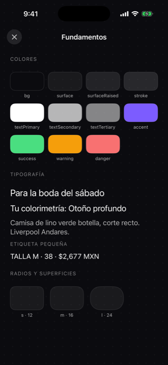 | 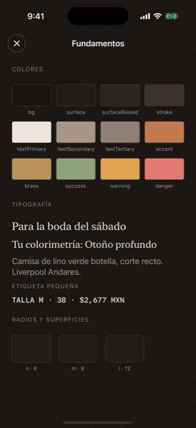 |
| Controles | 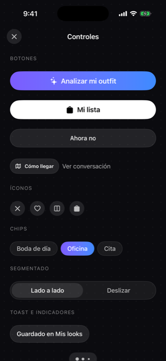 | 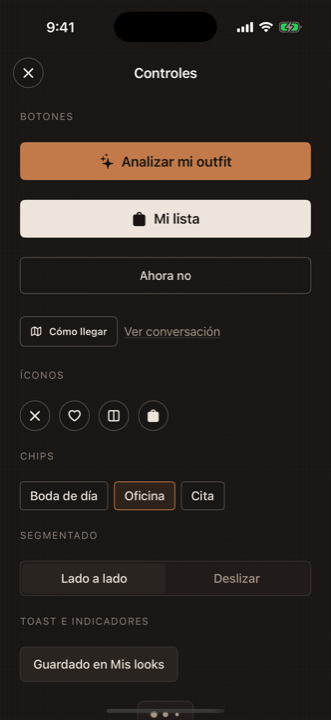 |
| Conversación, pasos 1–2 | 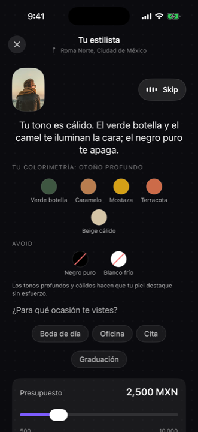 | 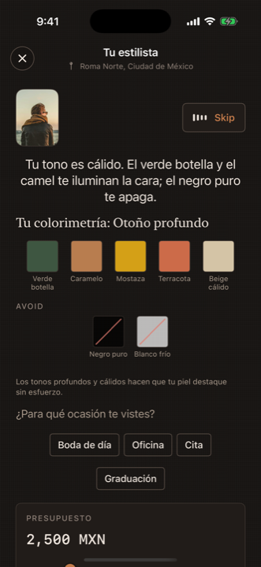 |
| Recomendación | 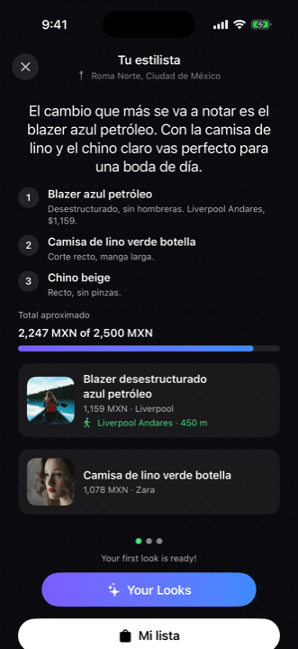 | 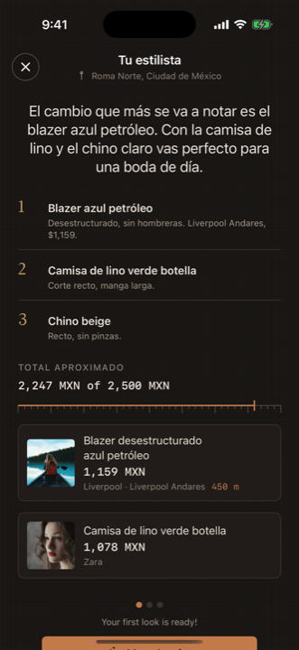 |
| Preview de estilo | 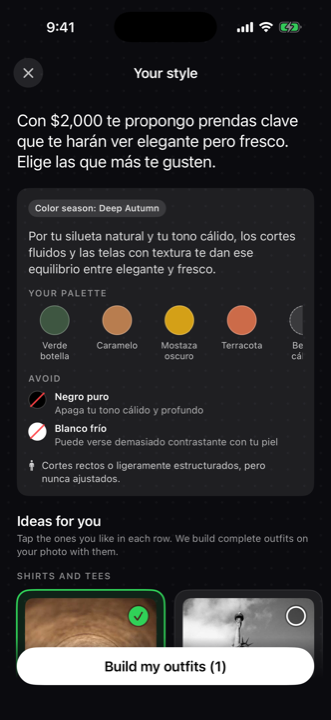 | 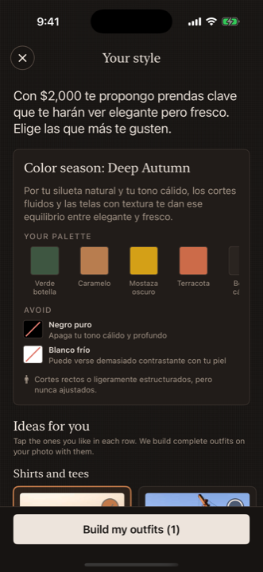 |
| Extras (overlay, foto, slider, antes/después) | — | 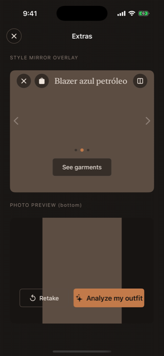 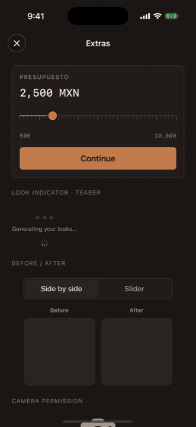 |

## 7. Fuera de alcance de esta capa

Flujo, ViewModels, servicios, modelos, contrato con el backend, orden de
pantallas y copys no se tocan desde el sistema de diseño. Tampoco se agregan
dependencias ni archivos de fuente: New York, SF y SF Mono vienen del sistema.
El nombre de la app y de la marca no se renombran aquí.
